<h1> OpenDockWatch</h1>

[](https://hub.docker.com/r/darks1d3r/opendockwatch)
[](https://hub.docker.com/r/darks1d3r/opendockwatch)
[](https://github.com/DarkS1D3R/OpenDockWatch/releases)
[](https://github.com/DarkS1D3R/OpenDockWatch/actions/workflows/ci.yml)

A small self-hosted Docker dashboard. See containers grouped by Compose project, with live CPU/memory, start/stop/restart, log tailing, alerts and a topology graph. It watches the local Docker daemon and any number of remote hosts over SSH. No orchestration — just visibility and basic control.

## Features

- **Hosts** — every host on one screen, problem hosts first.
- **List** — containers grouped by Compose project, live CPU/memory sparklines, start/stop/restart per container or per project (in `depends_on` order), service logos.
- **Container metrics** — CPU, memory, network and disk I/O history over 1h / 24h / 7d.
- **Flow** — topology graph with `depends_on`, shared-network and manual edges; blast-radius selection, group collapse, tree mode, PNG/SVG export.
- **Logs** — multi-pane log viewer with level filters, regex search, pause, jump to a time, and search across a whole Compose project.
- **Details panel** — ports, networks, env, mounts, labels, healthcheck results and a live log preview.
- **Image updates** — flags containers whose tag has moved on the registry (detection only, opt-in).
- **Activity** — alerts and the container event log side by side, filterable.
- **Uptime** — 24h / 7d / 30d per-container and per-host uptime report.
- **Resources** — read-only inventory of images, volumes and networks with sizes and "unused" flags.
- **Alerts** — crashes, OOM kills, crash loops, unhealthy, unreachable hosts and CPU/memory/disk thresholds, sent to Discord, Slack, ntfy, Gotify or any JSON webhook.
- **Podman** — supported through its Docker-compatible API.
- **Two roles** — admin, plus an optional read-only viewer login.

Full detail: [docs/features.md](docs/features.md).

## Screenshots

**List view** — containers grouped by Compose project, live CPU/memory columns

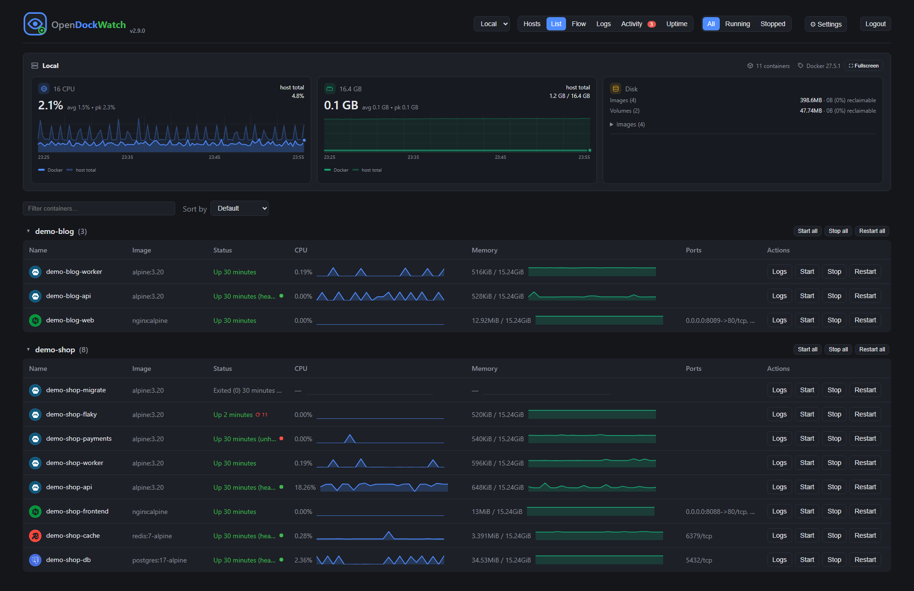

**Container metrics** — recorded history over 1h / 24h / 7d, one shared hover crosshair, step back through earlier windows

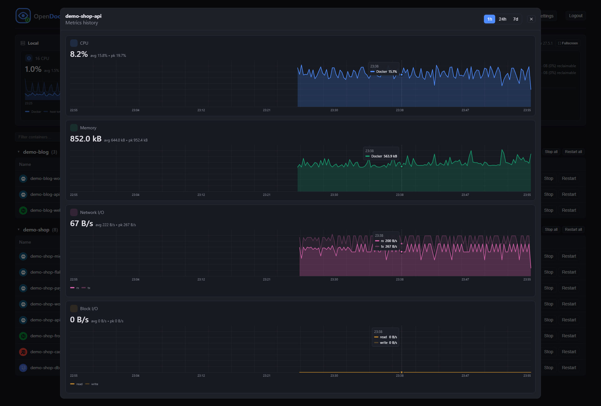

**Host history** — the host card fullscreen: CPU and RAM over live / 1h / 24h / 7d, paged back an hour, a day or a week at a time

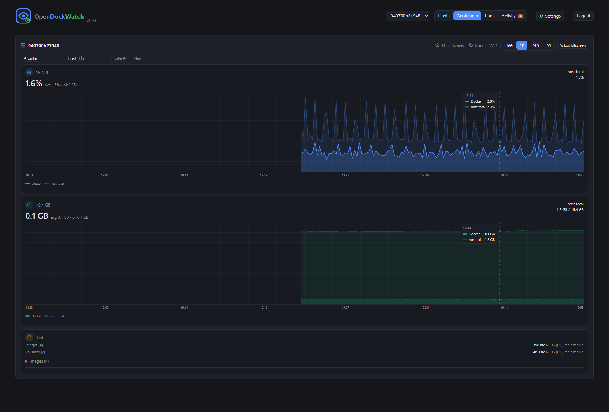

**Flow view** — topology graph with live stats and open-alert badges on each node

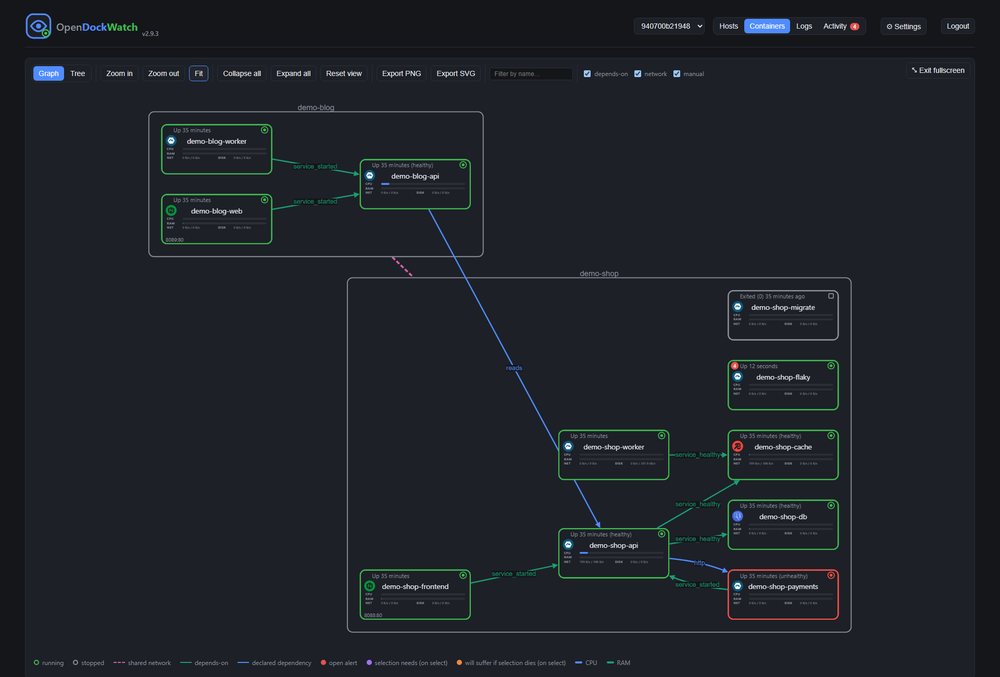

**Blast-radius selection** — what a node needs (purple) and what breaks if it dies (orange)

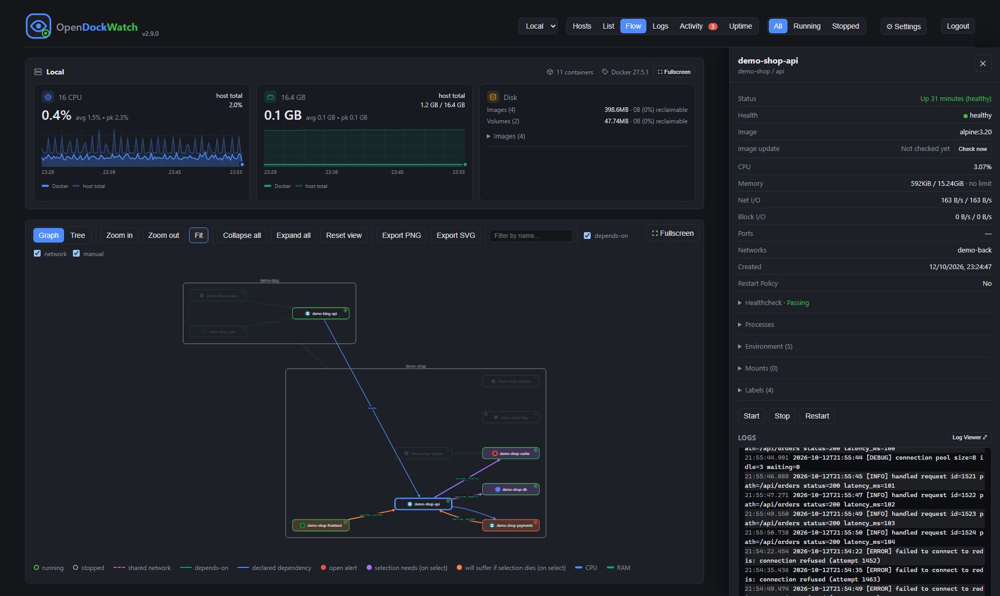

**Compose-group collapse** — a whole project as one aggregate box

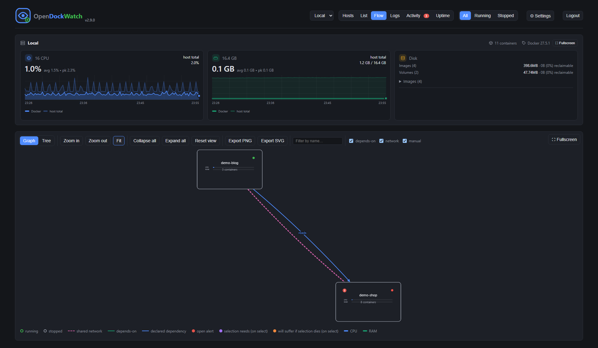

**Tree mode** — `project → container → network/volume`, shared infrastructure drawn once

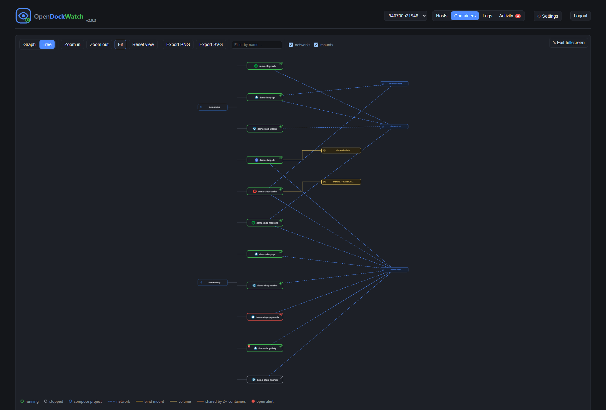

**Logs tab** — container list on the left, full log viewer on the right

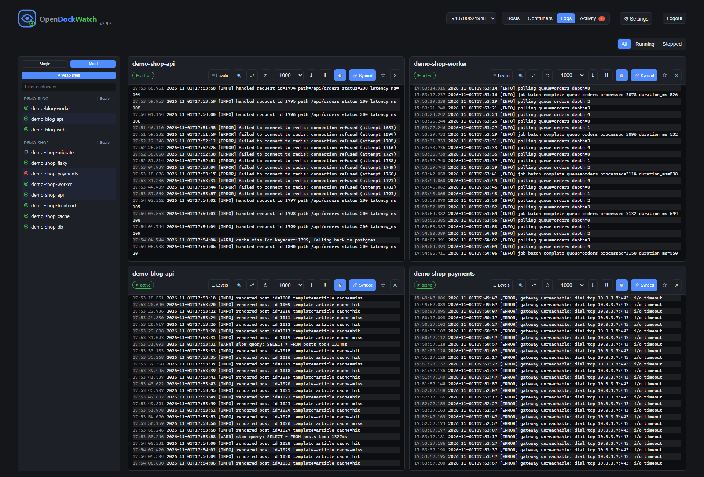

**Details panel** — status, stats, actions, log preview and `docker inspect` details

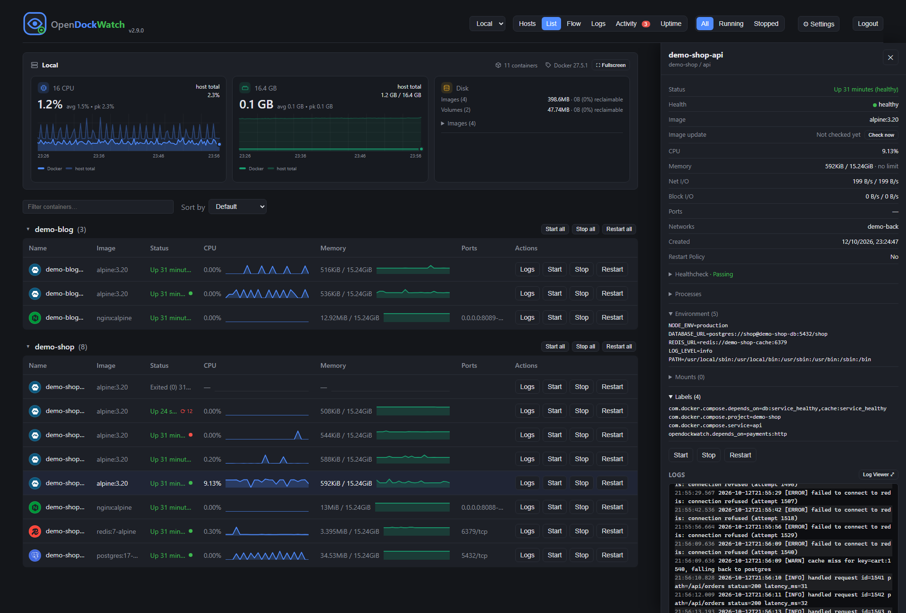

**Log Viewer** — level filters, regex search and download

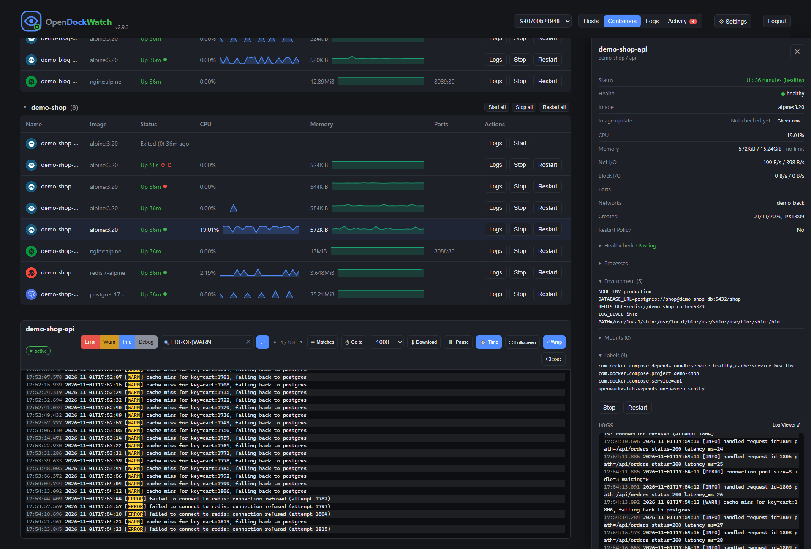

**Activity view** — alerts and the container event log side by side

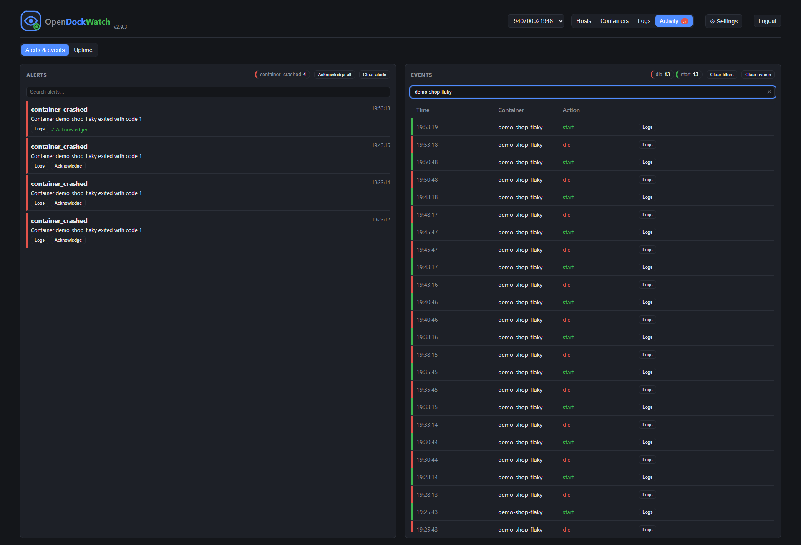

**Uptime** — per-container up / healthy percentages, down time and restarts over 24h / 7d / 30d

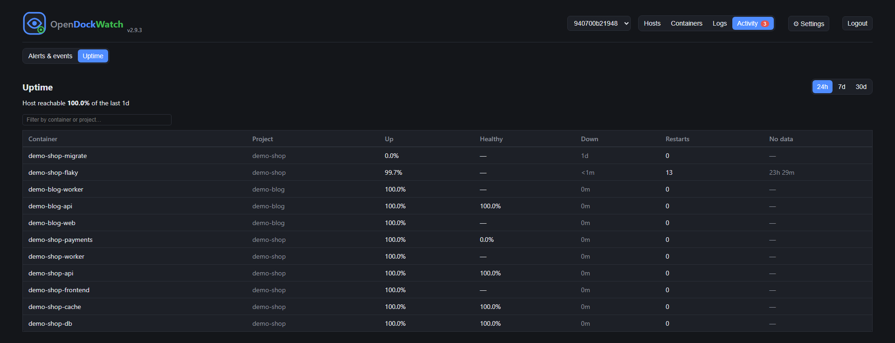

**Hosts tab** — every monitored host on one screen, problem hosts first

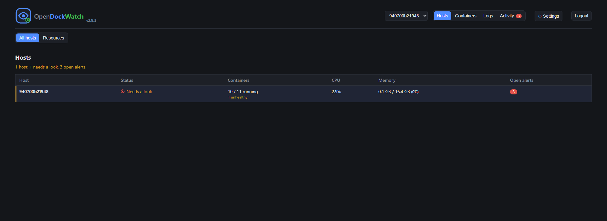

**Resources** — read-only inventory of images, volumes and networks, with what's unused

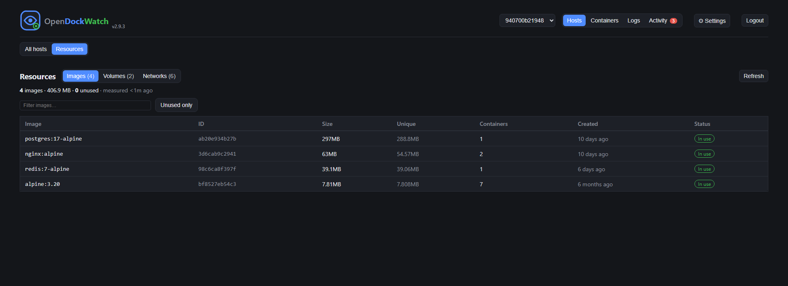

## Quick start

The image is [`darks1d3r/opendockwatch`](https://hub.docker.com/r/darks1d3r/opendockwatch) (`linux/amd64` + `linux/arm64`).

```
docker run -d --name opendockwatch \
  -p 3000:3000 \
  -v /var/run/docker.sock:/var/run/docker.sock \
  -v ~/.ssh:/root/.ssh:ro \
  -v ./config:/app/config \
  -v ./data:/app/data \
  -v ./.env:/app/.env:ro \
  darks1d3r/opendockwatch
```

Or build from a checkout with `docker compose up -d --build`. The `~/.ssh` mount lets the container reach remote hosts with your keys. If Docker runs inside WSL, run this from the WSL distro.

## Running from source

Needs Node.js 22+ and the `docker` CLI on PATH.

```
npm install
cp .env.example .env
cp config/hosts.example.json config/hosts.json
npm run hash-password -- "your-password"
npm start                                   # http://localhost:3000
```

In `.env`, set `AUTH_USER`, `AUTH_PASS_HASH` (the hash output) and a random `SESSION_SECRET`. For a read-only login, also set `VIEWER_USER` / `VIEWER_PASS_HASH`.

## Hosts

Add hosts in Settings → Hosts or in `config/hosts.json`. A remote host needs key-based SSH (no passphrase) to a user that can reach its Docker socket:

```json
{ "id": "prod", "name": "Production", "dockerHost": "ssh://deploy@prod.example.com" }
```

SSH access to a Docker socket is root-equivalent on that host, so treat the key accordingly. Behind a TLS-terminating reverse proxy, set `TRUST_PROXY=true`.

SSH setup, Podman, and the reverse-proxy details: [docs/hosts.md](docs/hosts.md).

## Alerts

Event rules (crash, unexpected exit, OOM kill, crash loop, unhealthy, host unreachable) are always on. Threshold rules are off until you set them, in `.env` or Settings → Alerts:

| Variable                  | Enables                                      |
| ------------------------- | -------------------------------------------- |
| `ALERT_CPU_THRESHOLD`     | container and host CPU alerts                |
| `ALERT_MEM_THRESHOLD`     | container and host memory alerts             |
| `ALERT_DISK_THRESHOLD_GB` | Docker disk footprint alert                  |
| `ALERT_WEBHOOK_URL`       | push notifications (Discord, Slack, ntfy, …) |

Rules, webhook URL formats, routes, reminders and escalation: [docs/alerts.md](docs/alerts.md).

## Contributing

Issues and PRs welcome — see [CONTRIBUTING.md](CONTRIBUTING.md) for dev setup.

## License

AGPL-3.0-or-later. See [LICENSE](LICENSE). You may use, self-host and modify OpenDockWatch, including inside an organization. If you distribute a modified version, or run one as a network service for others, you must make its source available under the same license.

## Third-party libraries

Vendored unmodified under `public/vendor/` (no build step). All MIT-licensed:

| Library                                                                                                        | Used for                      |
| -------------------------------------------------------------------------------------------------------------- | ----------------------------- |
| [Vue](https://github.com/vuejs/core)                                                                           | the frontend UI               |
| [Cytoscape.js](https://github.com/cytoscape/cytoscape.js)                                                      | Flow view graph               |
| [dagre](https://github.com/dagrejs/dagre) / [cytoscape-dagre](https://github.com/cytoscape/cytoscape.js-dagre) | automatic graph layout        |
| [cytoscape-node-html-label](https://github.com/kaluginserg/cytoscape-node-html-label)                          | HTML node content             |
| [cytoscape-expand-collapse](https://github.com/iVis-at-Bilkent/cytoscape.js-expand-collapse)                   | compose-group collapse/expand |
| [html2canvas-pro](https://github.com/yorickshan/html2canvas-pro)                                               | Flow view PNG export          |
